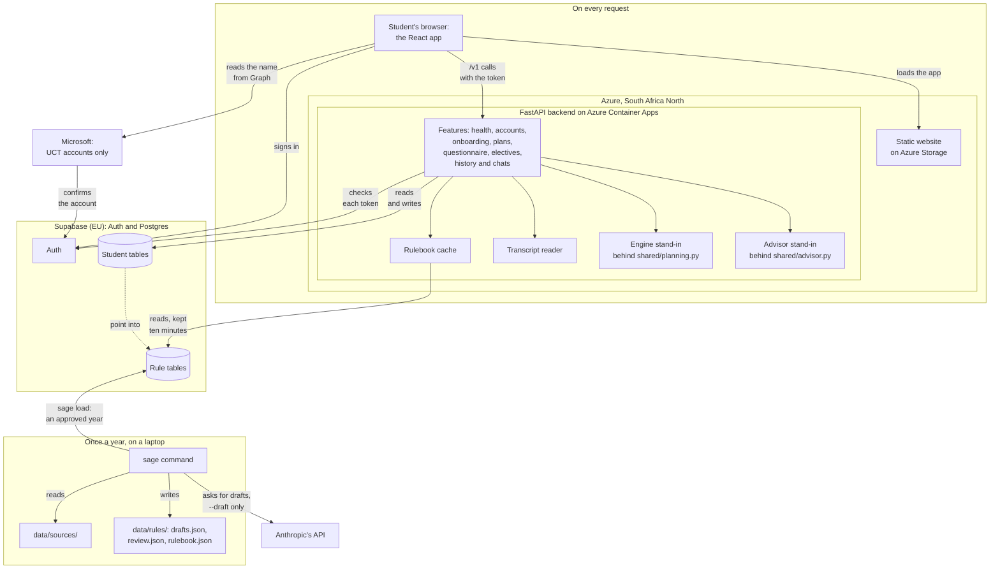
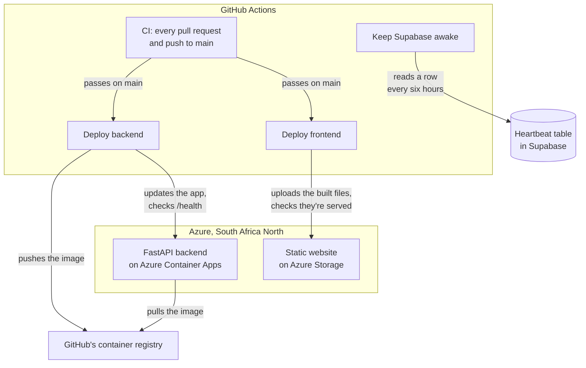
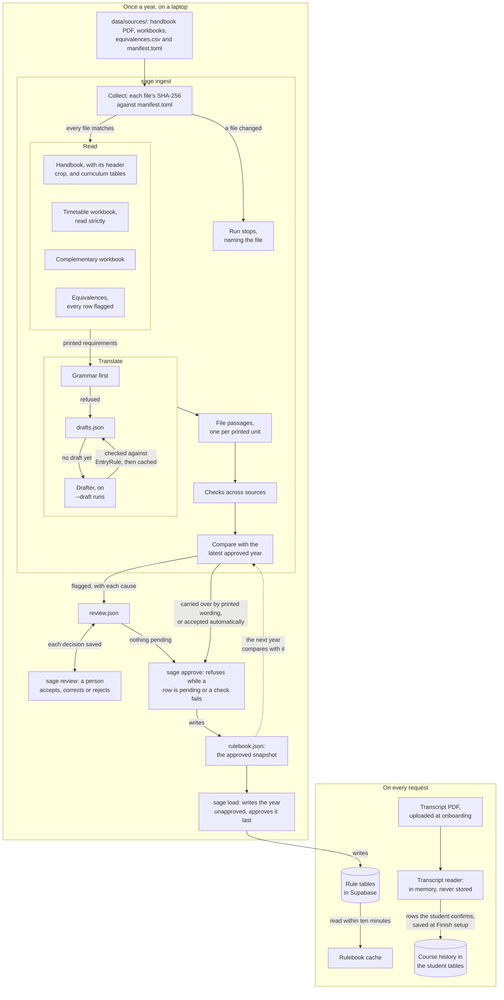

<!-- Component map and dependency rule for the whole system -->
# Architecture

## Where things live

Folders marked (planned) don't exist yet; each arrives with its first code.

| Folder | What it does |
| --- | --- |
| `backend/src/sage/main.py` | The app's frame: it builds the FastAPI app, fills the interfaces in `shared/` with Supabase and the stand-ins in `engine/` and `advisor/`, and mounts each feature's routes. `config.py` reads the settings |
| `backend/src/sage/cli.py` | The `sage` command, such as `sage seed`, which loads the made-up student's data onto an account once her plans' year is loaded, `sage sign-in`, which prints a one-time link that signs her in on local Supabase, and `sage ingest --year <year>`, which reads a handbook year's sources, compares them with the latest approved year and writes what needs a person to `data/rules/<year>/review.json`, with `--draft` to have a model draft what the grammar can't read, `sage review --year <year>`, which walks a person through the pending rows one at a time in the terminal, `sage approve --year <year>`, which writes the approved year once none is pending, and `sage load --year <year>`, which writes an approved year to the database `SUPABASE_URL` names, passes over one held exactly as its snapshot, and replaces one held differently only with `--replace` |
| `backend/src/sage/features/<feature>` | Everything one part of the API owns: its routes (`routes.py`), the service behind them (`service.py`) and its request and response bodies (`models.py`). The features are `health`, `accounts` (`/v1/me`), `onboarding`, `plans`, `questionnaire`, `electives`, `history` and `chats` |
| `backend/src/sage/ingestion` | Turns sources into data: a student's transcript into her course history, a printed requirement into a rule tree (the grammar, with a model's draft where it refuses), and a year's handbook, timetable, complementary workbook and equivalences into a candidate rulebook, through one reader per source and checks across the sources. `review.py` reviews that rulebook by exception against the latest approved year, as one row per printed thing a person must decide, and checks each decision against the reading it was made on and the year as decided. An approved year is kept as its snapshot. `ingest.py` runs a year's ingestion, review, approval and load for the `sage` command, and `anthropic.py` is the model that drafts what the grammar refuses, through the `Drafter` interface in `drafting.py` |
| `backend/src/sage/engine` | Will validate plans and generate every valid plan (clingo), filling `PlanGenerator` and `EligibilityChecker` in `shared/planning.py`. Until it lands, `stubs.py` stands in |
| `backend/src/sage/advisor` | Will be the conversational agent: engine tools, scoped context (the handbook passages for her courses, with no embeddings or search), guardrails and prompts, filling `Advisor` in `shared/advisor.py`. Until it lands, `stubs.py` stands in |
| `backend/src/sage/shared` | What two or more features or components use: the models and interfaces (the rule model, her rows, sign-in, every refusal, the stores, and the engine's and advisor's interfaces), the rule model in plain words (`wording.py`), the rulebook cache (`rulebook.py`), the made-up student (`seed.py`), the API's plumbing (`api/`: the guards, problem responses and shared bodies), Supabase (`supabase/`) and the in-memory fakes the unit tests use (`memory/`) |
| `backend/tests` | Unit and integration tests. The unit tests mirror the source, in `tests/unit/<package>/`. [testing.md](testing.md) has their rules and how to run them |
| `backend/scripts` | Measures the tests: the planted faults, and the line `make mutation` writes. Makes the fresh local account for onboarding and its made-up transcript (`make sign-in-new`, `make transcript`) |
| `frontend/` | React and TypeScript interface, deployed as static files. Its code is in `frontend/src`, in the five folders below, and Playwright's set-up and helpers are in `frontend/e2e` |
| `frontend/src/app` | The app's frame. `routes.tsx` is the route table: each page's address, who may open it, the guard that sends everyone else home, and the page's file in its owner's folder, loaded when first opened. `Root` gives each page its title, and `RouteError` shows when a page can't open. `AppLayout` is the frame around the student's pages: the sidebar, with the logo, the main navigation and the account (`AccountMenu`: who is signed in, Appearance and Sign Out), beside the page. `PlanWorkspace` opens her first plan from `/plan`, and shows the plan view at each plan's own address, where the assistant will sit beside it. `StaffPage` and `NotFoundPage` are stubs that wait for a second shell branch, and `ToastRegion` shows the toasts |
| `frontend/src/features/<feature>` | Everything one feature owns: its page, own components (in `components/<Name>`), hooks, copy and tests. Deleting the folder removes the feature. `onboarding` holds the sign-in landing and onboarding, `history` the Course History page, `plan` the plan view (the switcher, each term's week and list, and compare), `electives` its stub page, and `assistant` its first component, the chat box. M3 adds the rest: (planned) questionnaire |
| `frontend/src/components/<group>/<Name>` | The SAGE-styled primitives and patterns that features build on, plus anything two or more features use, one folder each with `Name.tsx`, `Name.module.css` and any test. They are built on React Aria Components, styled from the tokens, and grouped by job: `actions`, `inputs`, `overlays`, `feedback`, `content` and `brand`. A feature's specialised versions live in the feature |
| `frontend/src/lib` | Shared code with no markup: the API client and its generated types, the error map, the query client and every read's query with its refresh rules, the shared copy and page titles, the plan's address (`planAddress.ts`: the open plan, the plan it's compared with and the term, which the assistant and the electives page will read too), sign-in (`auth/`), the settings, the Supabase client, the appearance hook and the toast queue |
| `frontend/src/styles` | `tokens.css` (values shared by both themes) and `theme.css` (a light block and a dark block of colours), the only places a raw colour, size, radius, shadow or duration is written, `base.css`, and `outline.module.css`, the outlined look that secondary buttons and the Select share |
| `supabase/` | Database migrations |
| `data/` | `sources/<year>/`: each year's handbook, workbooks and equivalences, with `manifest.toml` holding each file's fingerprint. `rules/<year>/`: the cached model drafts (`drafts.json`), the rows a person must decide and each review sitting (`review.json`) and the approved snapshot (`rulebook.json`), which the next year is compared with and `sage load`, or `make load` for every approved year, writes to a database. These snapshots are SAGE's only source of rules. `synthetic/`: the made-up student's own data, which `sage seed` and `make sign-in` write once her plans' year is loaded. It holds no rules |

## System diagram

A solid arrow shows who acts on whom. Each lane is one clock, and Supabase sits between them, where they meet. On every request, the student's browser loads the React app from Azure Storage and signs in through Supabase Auth with a UCT Microsoft account. The browser also reads the student's name from Microsoft Graph, and the name stays there. Each call to the backend on Azure Container Apps carries the sign-in token, which the backend checks with Supabase Auth. The backend reads rules through the `Rulebook` cache, reads and writes the student tables, and never writes rules. The engine and the advisor are still stand-ins. The engine's stand-in gives every student Mbali's plans, from the seed file built into the image, and the advisor's refers every question to a human advisor. Once a year, on a laptop, the `sage` command reads `data/sources/`, asks Anthropic's API for drafts only on a `--draft` run, and writes `data/rules/`. Only `sage load` writes rules to the database.

### How code reaches Azure

An arrow shows who acts on whom. CI checks every pull request and every push to main. When it passes on main, Deploy backend builds the backend's image, pushes it to GitHub's container registry, points the container app at it and waits until `/health` reports the new commit. Deploy frontend builds the app, uploads it to Azure Storage and checks the site serves it. Keep Supabase awake reads one row every six hours, as Supabase pauses a free project after a week without database activity.

## Two clocks

- **Once a year, on a laptop.** The `sage` command runs ingestion. `sage ingest`, `sage review` and `sage approve` touch only files in `data/`, until `sage load` writes the approved year into the rule tables.
- **On every request, in the cloud.** The backend never writes rules. It reads the approved year into the `Rulebook` cache (`shared/rulebook.py`), which keeps each year for ten minutes, so a newly loaded year shows within that time with no redeploy. The engine will build plans from it, and the advisor its briefing pack from the passages and the plan reasons.
- **Supabase is where the two meet.** Student rows point into the rule tables, so the database refuses to remove a year a student's plan uses, and `sage seed` won't write a student's data until her plans' year is loaded.

The [system diagram](#system-diagram) above draws both clocks, and the [ingestion data flow](#ingestion-data-flow) below follows one handbook year from its sources to the cache.

## Ingestion data flow

An arrow shows where the data goes next. `sage ingest --year <year>` first checks each source's SHA-256 against `manifest.toml`, and a changed file stops the run. One reader per source then reads the handbook, the timetable workbook, the complementary workbook and the equivalences. The handbook reader crops off each page's running header, and the timetable reader is strict: a cell it can't place stops the run. Each printed requirement goes to the grammar first. A string it refuses takes its cached draft from `drafts.json`, and only a `--draft` run asks the model for a missing one, checking it against `EntryRule` before caching it. Without a draft, the string becomes a `refer` leaf. The handbook is cut into passages, one per printed unit, and the sources are checked against each other. The year is then compared with the latest approved year: a requirement printed in the same words carries over, a change read with certainty is accepted automatically, and everything else becomes a row in `review.json` with its causes. A person decides each row in `sage review`. `sage approve` reruns the reading, refuses while a row is pending or a check fails, and writes `rulebook.json`, which the next year is compared with. `sage load` writes the year unapproved and approves it last, so a load that stops partway never becomes the current year, and the `Rulebook` cache reads the new year within ten minutes. The transcript reader runs on the other clock: it reads a student's PDF in memory during onboarding and never stores it, and only the rows the student confirms are saved, at Finish setup.

## Backend dependency rule

Imports point inward, and `make check` enforces it: `make lint` checks import-linter's contracts in `backend/pyproject.toml`.

- `main.py` and `cli.py` → `features/` → `advisor/` → `engine/` and `ingestion/` → `shared/` → `config.py`. Each may import only what comes after it.
- Shared code never imports a feature, a component or an entry point. When two features need the same thing, it moves to `shared/`.
- Features don't import each other, except where one is built on another: the questionnaire and chats use plans, and onboarding uses accounts, as Finish setup answers with `/v1/me`'s body. Plans and accounts import no feature. The contract lists these three, so a new one is a decision: list it there, or move the shared part to `shared/`.
- Features reach the engine and the advisor only through `shared/planning.py` and `shared/advisor.py`, which `main.py` fills. So only `main.py` imports `engine/` and `advisor/`, and swapping in the real components never touches a feature.
- The advisor may call the engine (its tools). The engine and ingestion never import each other or the advisor.
- Each outside service's SDK has one home: Supabase's (`supabase`, `supabase_auth`, `postgrest` and `jwt`) in `shared/supabase/`, Anthropic's in `ingestion/anthropic.py`, its only user until the advisor needs a model too, and clingo's in `engine/` when the engine lands.
- Year and department are data, not code. Nothing in the code tree is named after a programme.

## Frontend dependency rule

Imports run one way, and `frontend/scripts/check-tsx.ts` (run by `npm run lint`) enforces it.

- Features use `components/`, `lib/` and `styles/`. Shared code never imports a feature, and features never import each other. When two features need the same thing, it moves to shared.
- `app/` may import features, and `lib/` may not, even through `import()`. So the route table, which loads each page from its feature, lives in `app/routes.tsx`, and sign-in, which every feature needs, lives in `lib/auth/`.
- A feature's specialised component is built from the shared base through its props, never by copying the base's markup or styles.
- Every import names what it uses, from the file that defines it: `import { Button } from '@/components/actions/Button/Button.tsx'`. There are no index files that re-export a folder, no `import * as`, and no default exports except where a tool needs one.
- `@/` points at `src/`. Imports within one folder use `./`.

## Privacy

- SAGE's own tables hold no names, email addresses or student numbers.
- Supabase Auth keeps each account's UCT email, which contains the student number. SAGE needs it to identify the account and to check that a transcript belongs to the person uploading it. Supabase Auth also keeps Microsoft's identifiers for the account, but no name: SAGE never asks Microsoft for the profile scope, which is what would bring one.
- SAGE works the student number out from the email when it needs it, and keeps no copy of its own.
- A student's name comes from Microsoft Graph at sign-in and stays in their browser.

## Future work

- Semester check-ins are in the design, but won't be built before submission.
